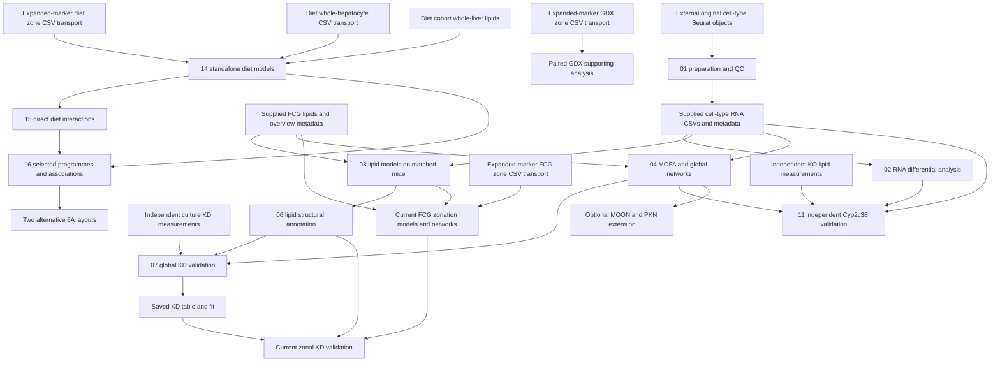
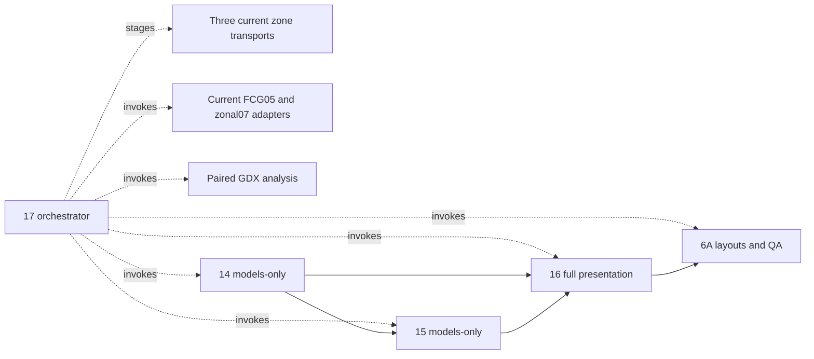

# Pipeline, data dependencies and provenance

The current zonation and standalone diet release is **expanded_markers_20261116**, selected by [analysis_release.json](scripts/config/analysis_release.json). Its approved output root is `results/zonation_marker_update_20261116/`. Numbering identifies workflows; it is not execution order.

Use the [complete workflow reference](docs/WORKFLOW_REFERENCE.md) for each entry's actual file inputs, producers, execution modes, outputs, validation scope and overwrite behavior. It is generated from the [editable JSON contract](docs/workflow_dependencies.json); the same relationships are available as a [filterable dependency CSV](docs/workflow_dependencies.csv) and [workflow catalog](docs/analysis_catalog.csv). The detailed [workflow plans](docs/workflow_plans/) describe methods and limitations.

## Scientific data flow

Solid arrows below represent data/artifact dependencies. The second diagram shows orchestration separately. A shipped derived artifact can be read without rerunning its producer.



Support regulons, gene sets, validation measurements and auxiliary annotations are itemized in the complete reference. Workflow08 is a separate raw-lipid/metadata variance analysis; it does not consume03 or RNA. Workflow09 requires an externally supplied mouse signature and human data. Workflow10 is an independent raw Xenium branch with known execution blockers, not an output of02's panel-restricted FCG volcano plot.

## Current zonation and diet orchestration



Dotted arrows are calls; they do not imply that the diet cohort uses original FCG estimates. The diet study is analysed independently. Age differences preclude a simple causal bridge to the original cohort. RNA zones are paired profiles within each mouse; lipid measurements are whole-liver. Diet association and threshold-defined edge gains/losses remain exploratory.

### Files required before Workflow17

| Input group | Producer / handoff | Availability |
| --- | --- | --- |
| Current FCG, GDX and diet zone manifests and all layers | Supplied expanded-marker pseudobulks; registry `current_*_zonation_transport` | Shipped split CSV transports |
| Diet whole-hepatocyte manifest | Registry `wdsd_hepatocytes_transport`; mandatory14 intake even in models-only mode | Shipped; additional to the diet zone data |
| FCG and diet lipid measurements; TF/pathway resources | Curated input files under `data/` and `support/` | Shipped; exact files in the reference |
| `results/lipidomic/ttop_full_list.RData` and `enrichment/lipid_class_enrichment_scores.RData` | Workflow03 | Shipped derived prerequisites |
| `results/lipidomic/structural_model/lipids_with_structure.csv` | Workflow06; consumed by zonal07 structural plots | Shipped derived prerequisite |
| `results/validation/knockdown_t_table.csv` and `knockdown_ttop_list.RData` | Independent KD fit in Workflow07 global branch | Shipped derived prerequisites; KD measurements are unchanged |

Workflow17 does **not** run03,06 or the independent KD fit producer. Neither04's MOFA fit nor historical FCG zonation results are required for its default scientific branch. Current inputs use [CSV transports](docs/PSEUDOBULK_CSV_INPUTS.md); registry `current_input_root` and the `*_rds` keys identify local originals/compatibility exports, not the public transport root.

## Reproducing from a public checkout

Run maintained R entries from the repository root with the required packages installed. Reading shipped panels and tables needs no model refit. Reproducing full Workflow01 requires excluded original whole-cell-type FCG/GDX Seurat objects; public downstream analyses can start from the committed cell-type CSVs instead. Workflow00 is a legacy HPC preprocessing reference, with an explicit external import/name handoff to01; it did not generate the current expanded-marker transports as a reproducible numbered step.

For the current zonation/diet branch:

```sh
# No fitting or writes: checks three zone transports, engine files and saved KD files.
Rscript scripts/workflows/17_expanded_marker_zonation_update.R --validate-only

# Full scientific rerun into a new directory, including fresh diet-parent handoffs.
Rscript scripts/workflows/17_expanded_marker_zonation_update.R --output=results/runs/expanded_markers_reproduction
```

Validation17 does not check every full-run03/06/resource prerequisite. Its optional `--with-manuscript-audit` validation adds selected historical cache/Python checks, not a complete manuscript-audit restoration test. Full manuscript auditing requires additional local historical caches, preprocessing references and a private DOCX. `--report-only` intentionally refreshes reports/source copies from saved results and writes files; it cannot rebuild missing model caches. See [the17 plan](docs/workflow_plans/17_expanded_marker_zonation_update.md) for the shared `--source-root` requirements of full private auditing.

### Manual diet-only execution

For a new diet run without FCG/GDX, use a fresh destination at every stage and pass the new parents explicitly:

```sh
Rscript scripts/workflows/14_cf453_standalone_figure6.R --models-only --output=results/runs/diet_models
Rscript scripts/workflows/15_cf453_diet_impact_figure6.R --models-only --parent=results/runs/diet_models/models.rds --output=results/runs/diet_direct
Rscript scripts/workflows/16_cf453_diet_rewiring_figure6.R --parent=results/runs/diet_models/models.rds --direct=results/runs/diet_direct/diet_analysis.rds --output=results/runs/diet_rewiring
Rscript scripts/reports/cf453_figure6a_layouts.R --parent=results/runs/diet_rewiring/rewiring_analysis.rds --output=results/runs/diet_layouts
```

Adjacent parent provenance is required. Defaults15/16 point to the approved release, not whichever fresh sibling directory was most recently written. Ignored `.rds` caches are absent in a public checkout and must be regenerated or restored before cache-consuming modes. Workflow16 `--models-only` still performs its full numerical/resampling stage;14/15/16 have no `--validate-only` option.

## Execution and overwrite limits

- Current full public05/07 zonal,14,17 and6A-layout entries reject the approved release root and descendants independently of cache presence. Fresh destinations remain required. Existing generic freshness guards also apply. Explicit saved-result refresh modes have their own documented write semantics.
- Workflows01–04,06 and08 execute on source and have fixed output paths, without a safe validation CLI or general fresh-output option. Use an isolated checkout/copy for a reproduction. Passing `--help` does not make these scripts read-only. `analysis_config.R`/`DATASETS` do not globally redirect their literal paths.
- Workflow04 loads retained MOFA models if all eleven factor-count model files are present; otherwise it automatically enters training. MOFA2 remains required for cached analysis.
- Workflow07 `--global-only --output=<fresh>` regenerates independent KD/global/structural validation separately from the current zonal branch. It reads04 network and06 structural artifacts. Its validation mode is a prerequisite check; Workflow11's `--validate-only`, by contrast, fits the observed weighted limma model in memory.
- Internal staging/engine helpers are called by maintained public entries; direct helper execution is not a substitute for the public rerun contract. Frozen05/07 bodies remain under `scripts/core/engines/`.

Validation is workflow-specific. The complete reference describes its exact scope and which commands mutate saved outputs. No validation flag alone certifies scientific reproducibility.

## Frozen references, optional branches and provenance

| Branch | Required reference | Boundary |
| --- | --- | --- |
| Historical12/13 and phase wrappers05b/05c | Original two-marker inputs/networks selected by explicit historical registry keys | Do not substitute current zones; CF459 lacks matching expanded-marker input |
| Independent11 and wrappers07b/07c | Whole-hepatocyte FCG, frozen04 pairs, independent KO data | No expanded-marker zonation dependency |
| Human09 / Xenium10 | External raw inputs and software/resources | Optional;10 requires code/input review before end-to-end execution |
| COSMOS/MOON/PKN | Frozen factors/priors/extraction states and branch-specific references | Active optional extension; see [causal map](docs/CAUSAL_ANALYSIS_MAP.md); full fits have a separate pinned environment |

[Organization/provenance](docs/REPOSITORY_ORGANIZATION.md) maps archived inputs/results and recovery by recorded path/SHA256. Historical manifests retain their original embedded paths and hashes. Strict historical code/plan snapshot QA may report drift after documentation edits; that differs from checking preserved scientific bytes or ordinary parent-cache validity. Do not update frozen hashes to conceal a mismatch.

Figure4A/S4B–C and their nucleus-level counts/composition tests remain James's tasks; pseudobulks cannot reconstruct them. Exact executed retained-marker lists also await James's confirmation.

To adopt a future release, preserve and validate it before changing the registry, input/result manifests and documentation. For documentation edits, update the JSON contract and matching plan, regenerate the reference, then run:

```sh
python3 scripts/maintenance/build_workflow_documentation.py --check
python3 scripts/maintenance/verify_repository_organization.py
python3 scripts/maintenance/audit_github_readiness.py --strict
```

The [18 November documentation audit](docs/provenance/workflow_documentation_audit_20261118.json) records coverage, preservation and guard-only changes. The earlier layered overview is preserved under [miscellaneous/documentation/dependency_audit_20261118](miscellaneous/documentation/dependency_audit_20261118/README.md).
