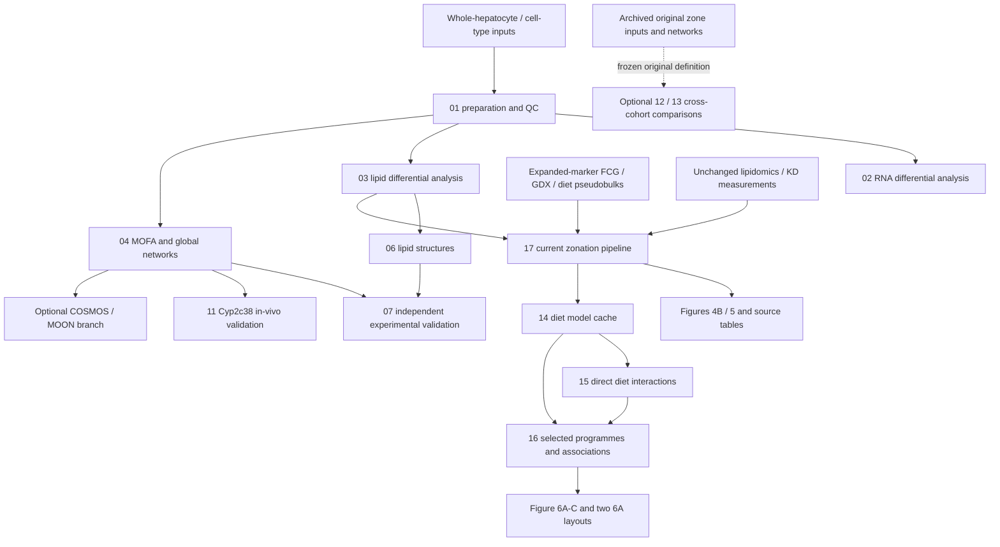

# Main pipeline, dependencies and provenance

The current zonation default is release `expanded_markers_20261116`, selected in [the release registry](scripts/config/analysis_release.json). This document supersedes the earlier unnumbered-script execution guide, preserved under `miscellaneous/documentation/pre_cleanup_20261116/PIPELINE.md`.

## Execution graph

RNA zones are paired within mouse; lipid abundance is whole-liver, not zone-resolved. The standalone diet study is not a test of an age-matched relation to the original cohort. Exact contrasts and multiple-testing families are specified in the per-workflow plans.

## Current inputs and output roots

| Component | Inputs | Producer and current outputs |
| --- | --- | --- |
| Whole-cell RNA analysis | `data/RNA/scaled_RNA_{1,2,3}.csv`, RNA metadata | 01 → 02 → `results/pseudobulk/` |
| Lipid models | cleaned lipid matrix, overview workbook | 03 → `results/lipidomic/` |
| Global integration | whole-cell RNA + lipid measurements + trained model set | 04 → `results/mofa/` |
| FCG zonation | `data/RNA/pseudobulk_csv/current_fcg_zonation/manifest.json` and supplied scale layer | 17 → current release `fcg05/` |
| Zonation KD validation | current FCG networks + unchanged experimental KD tables | 17 → current release `fcg07/` |
| GDX supporting analysis | `data/RNA/pseudobulk_csv/current_gdx_zonation/manifest.json` | 17 → current release `gdx_zonation/` |
| Standalone diet models | `data/RNA/pseudobulk_csv/current_wdsd_zonation/manifest.json`, CF453 lipids | 14 → current release `cf453_models/` |
| Direct diet tests | new 14 cache | 15 → current release `cf453_direct_diet/` |
| Current Figure 6 | new 14/15 caches | 16 → current release `cf453_rewiring/`; layouts → `cf453_layouts/` |
| Revised tables | FCG DE/selection/networks + KD scores | current release `tables/` |
| Panel/numerical audit | saved results and optional private DOCX | current release `report/`; source manuscript never modified |

Here, **current release** means `results/zonation_marker_update_20261116/`. Its original staged inputs and source snapshots remain provenance records. The public CSV inputs preserve the source values and are tracked by [current_input_manifest.csv](docs/provenance/current_input_manifest.csv).

CSV input policy and original-object provenance are detailed in [PSEUDOBULK_CSV_INPUTS.md](docs/PSEUDOBULK_CSV_INPUTS.md). Serialized RNA/Seurat inputs are excluded from Git.

## Running and validating

Run all numbered R entries from the repository root. Whole-cell CSVs are supplied for downstream models; regenerating those CSVs with01 requires the original whole-cell Seurat objects, which stay local; current zonation inputs are distributed as split CSVs, each under 50 MB. Start with `Rscript scripts/workflows/17_expanded_marker_zonation_update.R --validate-only`, then use a **fresh** `--output=results/runs/<name>` for a reproduction. The immutable approved release is never overwritten by a normal full rerun. Workflow 17's default is scientific models/panels/source tables; private manuscript auditing is explicit opt-in. Individual 14/15/16 entries resolve current parents through the release registry.

Workflows 01–04, 06–08 and 11 retain their documented main-study roles. Use `Rscript scripts/workflows/07_validation_experiments.R --global-only --output=results/runs/independent_validation` to regenerate independent KD/global/structural validation into a fresh directory; `--global-only --validate-only` checks that branch without writes. Old 05/07 source bodies are preserved as internal engines under `scripts/core/engines/`; the public entries and the current adapter distinguish current results from historical reference replay. Read the matching plan before modifying any entry.

This cleanup changes organization and defaults, not model definitions, thresholds, bootstrap draws or result values. Path and saved-artifact replay checks are recorded in the cleanup verification outputs. A new scientific run is required only to generate a new release, not to inspect the approved results.

## Frozen references and optional branches

| Branch | Frozen dependency | Why it must remain distinct |
| --- | --- | --- |
| Old/new zonation validation | original FCG/GDX zone inputs and archived FCG model | Reproduces the published baseline and quantifies the input change |
| 12 standard/Western-diet comparison | original Figure 3/5 networks and original FCG/CF453 zones | Historical coefficients/selected edges are tied to that compartment definition |
| 13 male WD cross-cohort analysis | original Figure 5 male networks, original CF453/CF459 zones | CF459 has no matching expanded-marker input; mixing definitions would change the question |
| COSMOS/MOON | frozen priors, factor inputs, selection states and expected solutions | Model scoring/extraction provenance and selected-result replay |

The [organization map](docs/REPOSITORY_ORGANIZATION.md) and [causal map](docs/CAUSAL_ANALYSIS_MAP.md) locate these dependencies. Archived payloads remain local and hash-verifiable; GitHub inclusion/restoration rules are in [the commit guide](docs/GITHUB_COMMIT_GUIDE.md).

## Release changes

Do not point frozen reference keys at current results. To adopt a future scientific rerun, validate it, preserve the previous release, and update `scripts/config/analysis_release.json` together with the input/result manifests and documentation. Record any path relocation externally; do not rewrite original embedded SHA256 or absolute-path records to make them appear newly generated.
